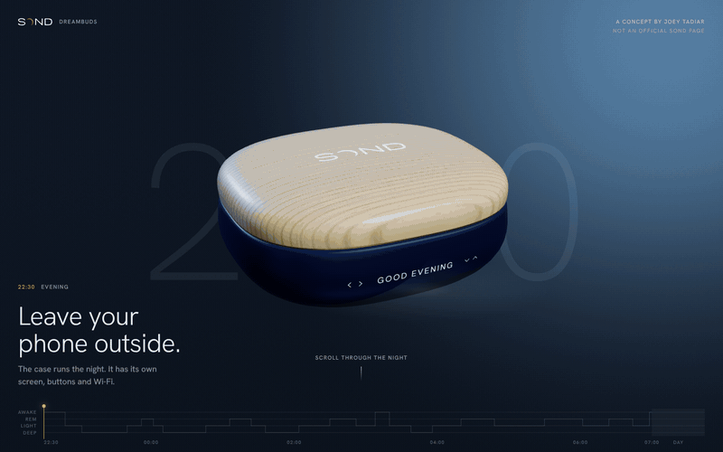

# SOND. One night. A 3D product site

A scroll-driven 3D product site for SOND sleep earbuds. You scroll through one night, from 22:30 to 07:00, and the product tells its story hour by hour.

**Live site:** [joeytadiar.com/sond/live](https://joeytadiar.com/sond/live/)

An unsolicited concept. Not affiliated with or endorsed by SOND.

## Built with

- Blender, for the product model
- three.js, for the 3D scene in the browser
- Plain HTML, CSS and JavaScript, in one file

## How it works

**One file.** The whole site is `index.html`. The 3D model is stored inside it as text, so the page loads the product without fetching anything else. three.js comes from a public CDN.

**Scroll is the clock.** Scrolling does not move the page. It moves through nine chapters of one night: Evening, Open, Lights out, Sensing, Up close, Deep sleep, Awake, Dawn and Morning. A large clock behind the product counts the time as you go.

**The sky changes with the hour.** Dusk blue at the start, near black at 2am, a warm horizon at dawn. The reflections on the glossy case come from a small virtual studio of soft lights.

**Textures drawn in code.** The oak lid, the wordmark and the face plates are drawn on the fly in the browser, not loaded as images. The case has a working display strip that changes its message through the night: Good evening, Sleep mode, Sensing, Alarm 07:00.

**A sleep chart as the scrollbar.** The bar along the bottom is a hypnogram, a chart of sleep stages across an example night. It shows where you are and you can drag it to jump.

**Try it.** At 3am the page invites you to double tap. The sleep coach answers, and a breathing ring guides you in and out.

**Controls.** Scroll, swipe, the arrow keys or drag along the sleep chart.

## My role

Designed and built by Joey Tadiar. Concept, art direction, copy, interaction and code.

## Run it locally

1. `git clone https://github.com/jtadiar/sond-3d.git`
2. `cd sond-3d`
3. `python3 -m http.server 8000`
4. Open [http://localhost:8000](http://localhost:8000)

You need an internet connection for three.js and the web fonts.

---

Code © Joey Tadiar. SOND and its product design belong to their owners.
